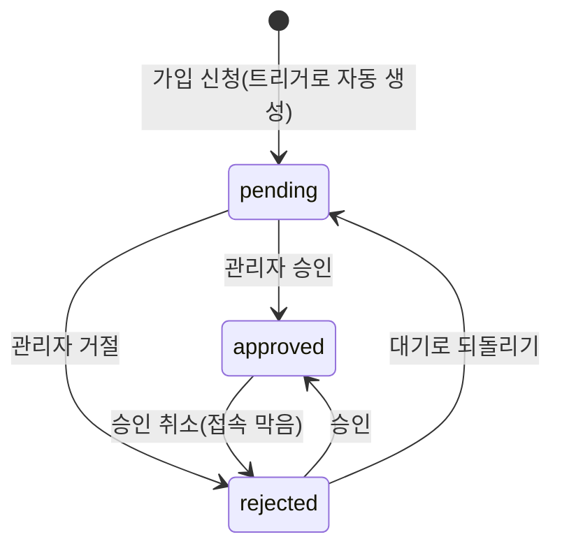
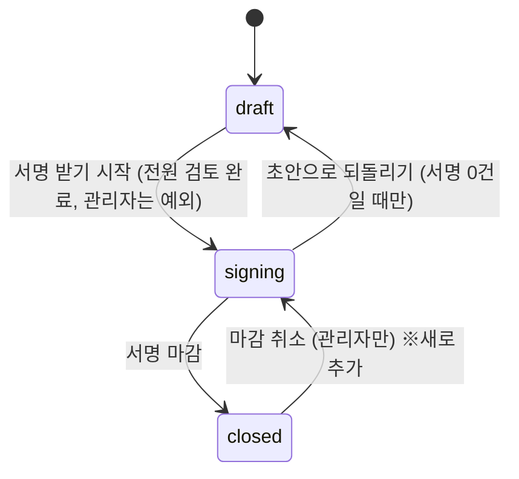
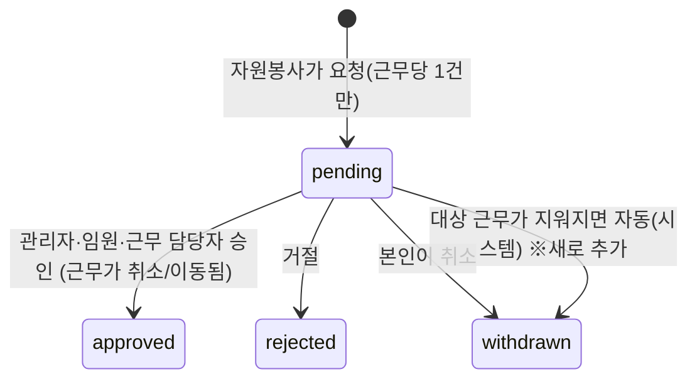

# 상태 머신 목록 (State Machines)

이 앱에는 "상태가 있고, 어떤 순서로만 바뀌는" 흐름이 많아요. 대부분 처음부터 설계된 게 아니라 **DB 트리거·RLS + 화면의 `if (status === …)`로 암묵적으로** 만들어졌습니다.
이 문서는 그것을 한 곳에 명시한 것이고, 코드의 **단일 출처는 [`states.js`](../states.js)** 입니다(라벨·전환·누가·어디서 막는지).

> 원칙: **실제로 막는 곳은 DB**(트리거·RLS·함수)입니다. 화면은 안내·버튼 표시만 합니다. 규칙을 바꿀 때는 ① `supabase-*.sql` ② `states.js` ③ 이 문서를 **함께** 고치세요.

## 1. 저장되는 상태 머신 (DB 열 기준)

### 1-1. 가입·접속 `profiles.status`

- 막는 곳: RLS(본인은 못 바꿈) · 화면 `members.html`
- 직책(`position`)·`role`·`shift_manager`는 상태가 아니라 **속성**이며 관리자만 바꿔요. 직책별 권한은 `role_permissions`.
- 접속 막힘이 이미 열린 화면에 늦게 반영되던 문제 → **탭으로 돌아올 때 다시 확인**하도록 `guard.js`에 추가.

### 1-2. 회의록 `meetings.status`

- 막는 곳: `meetings_guard` 트리거. `signing` 이후 **내용은 계속 잠김**.
- 딸린 흐름: 검토 완료(`meeting_reviews`), 수정 제안(1-3), 서명(`meeting_signatures`, 한 번 하면 수정 불가·관리자만 삭제).
- **막다른 길이었던 점**: `closed`에서는 어떤 방법으로도 되돌릴 수 없어서, 서명 마감을 너무 일찍 누르면 서명을 더 못 받았음 → 관리자 "마감 취소" 추가(`supabase-state-fixes.sql`).

### 1-3. 회의록 수정 제안 `meeting_suggestions.status`
`pending → accepted | rejected | withdrawn` (직접 수정 불가, `decide_suggestion()` 함수로만). 반영(accepted)할 때 본문이 바뀌고 `meeting_changes`에 제안자와 함께 기록.

### 1-4. 감사 보고서 `audit_reports.status`
`draft → submitted` (서명·의견·불러온 내용 필수) / `submitted → draft` 관리자만(서명 삭제). `audit_reports_guard` 트리거. 제출 시 내용 지문(content_hash) 저장.

### 1-5. 업무 `tasks.status`
`todo / doing / done` — **전환 제한 없음**(누구든 업무를 고칠 수 있으면 아무 상태로). DB는 값 범위만 검사. 담당자는 메인(1명 이하, 부분 유니크 인덱스)·보조(0명 이상).

### 1-6. 근무 변경 요청 `shift_change_requests.status`

- 막는 곳: `decide_shift_change()` 함수. 승인자: `can_approve_shift()`(관리자 / 승인 권한 직책 / 근무 담당자, **자원봉사 제외**).
- **고아 요청 문제였던 점**: 근무가 지워져도 요청이 영원히 "승인 대기"로 남았음 → 근무 삭제 트리거가 자동 취소.

### 1-7. 회의 참석 응답 `meeting_rsvps.response`
`(없음) → 참석 | 불참 | 미정`, 언제든 본인만 변경. 자원봉사는 응답 불가(재적 위원 아님). 지난 회의는 화면에서 응답 버튼을 숨김.

### 1-8. 기록용 종류 (상태 아님, 자동 기록) `shift_history.action`
`apply / remove / move / request / reject / withdraw` — 트리거가 쌓는 감사 기록(직접 쓰기 불가).

## 2. 값으로 저장되지 않는 "파생 상태" (화면이 계산)
| 대상 | 상태 | 계산 방법 |
|---|---|---|
| 회의록 검토 | 검토 전 → 검토 완료 → **수정됨** | 검토 때 저장한 `content_hash` ≠ 현재 `meeting_content_hash()` |
| 공지 | 안 읽음 → 읽음 | `notice_reads`에 내 행이 있는지(작성자 본인 글은 읽음) |
| 회의 일정 | 다가오는 → 지난 | `event_date` vs 오늘. 회의록이 만들어지면 `meetings.event_id`로 연결 |
| 봉사 시간(월) | 미확인 → 확인됨 → **확인 후 근무 변경됨** | `volunteer_hour_confirmations` 유무, 확인 당시 `auto_minutes` ≠ 지금 집계 |
| 근무 | 신청됨 → (변경 요청 중) → 지난 근무 | 요청 유무, 날짜 vs 오늘. 지난 근무는 변경 요청 버튼 숨김 |
| 지출 증빙 | 완비 ↔ 확인 필요 | 영수증 수, 증빙 종류, 회의운영비 기준(1인 5,000원·월 2회·주류 확인·회의록 연결) |

## 3. 화면(클라이언트) 쪽 암묵 상태
| 위치 | 상태 | 비고 |
|---|---|---|
| `guard.js` | 확인 중(화면 숨김) → 승인됨(화면 표시) / 로그인 필요(이동) / **연결 문제(다시 시도)** | 연결이 끊겨도 로그아웃시키지 않음. 다른 탭 로그아웃도 이 탭에 반영 |
| `index.html` | 로그인 / 가입 신청 / 비밀번호 재설정 요청 / 새 비밀번호 입력(복구 링크) / 승인 대기 안내 | 상태 전환이 `hide` 클래스로만 흩어져 있었음(그대로 두고 문서화) |
| 작성 화면(회의록·감사) | 새 글 → 작성 중(저장 안 됨) → 저장됨 | **저장 안 한 내용 경고**(`Unsaved`) 추가 |
| 각 화면 | 불러오는 중 → 표시 / 비어 있음 / 오류 | **"불러오는 중…" 표시**(`loadingBox`) 추가 |
| 처리 버튼 | 대기 → 처리 중 → 완료 | 승인·응답·검토 등 **중복 클릭 방지**(`actOnce`) 추가 |

## 4. 남겨 둔 것(아직 안 고친 것) — 결정 필요
1. **공지가 수정돼도 읽음이 유지됨**: 내용이 바뀌어도 "안 읽음"으로 돌아가지 않음. 고치려면 `notice_reads` 갱신 권한이 필요(DB 변경).
2. **업무 상태는 자유 전환**: 완료된 업무를 다시 열어도 이력이 없음(업무 변경 이력 표가 없음).
3. **브라우저 뒤로 가기(popstate)** 는 저장 안 한 내용 경고를 못 띄움(닫기·새로고침·화면 안의 "← 목록"은 경고함).
4. 이미 열려 있는 화면의 자료는 **자동으로 새로 고쳐지지 않음**(다른 사람이 승인해도 새로고침 전에는 안 보임).

## 5. 개발자(DX) 안내
- 상태 라벨은 **`States.label('meeting','draft')`**, 목록은 `States.labels('task')`. 화면 코드에 라벨 문자열을 새로 쓰지 마세요.
- 새 상태/전환을 추가할 때: ① SQL(CHECK·트리거) → ② `states.js` → ③ 이 문서 → ④ 화면 버튼. 시험은 SQL을 `raise exception 'DRYRUN …'`로 끝내는 되돌리기 시험으로.
- 눌러서 처리하는 버튼은 `onclick: actOnce(async function () { … })` 로 감싸세요. 작성 화면은 `Unsaved.watch/start/clear`.

## 6. 에이전트(AX) 안내
- 브라우저에서 `JSON.stringify(States.describe())` 로 전체 명세를 읽을 수 있어요.
- 상태를 보여 주는 라벨에는 `data-machine`·`data-state` 속성이 있어요(예: `[data-machine="meeting"][data-state="signing"]`). 불러오는 중에는 `[data-state="loading"]`.
- 화면 시험은 Edge 헤드리스 + 가짜 Supabase(`_t_*.html`, gitignore) 방식. DB 시험은 한 번에 `do $$ … raise exception 'DRYRUN RESULT => %' $$;`로 되돌리기.
- DB 변경은 실행 전에 사용자 확인이 필요해요(CLAUDE.md).
